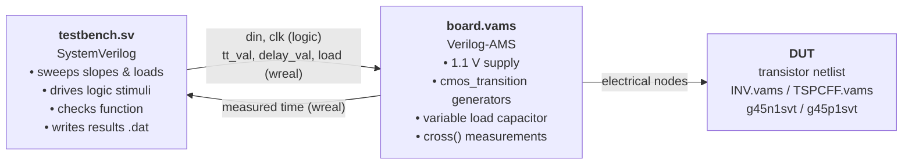
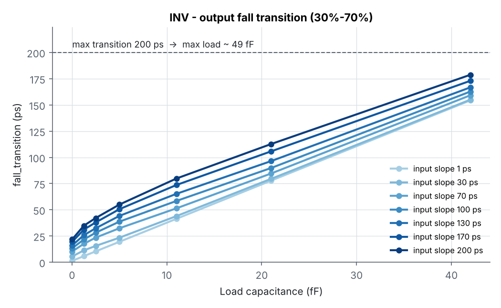
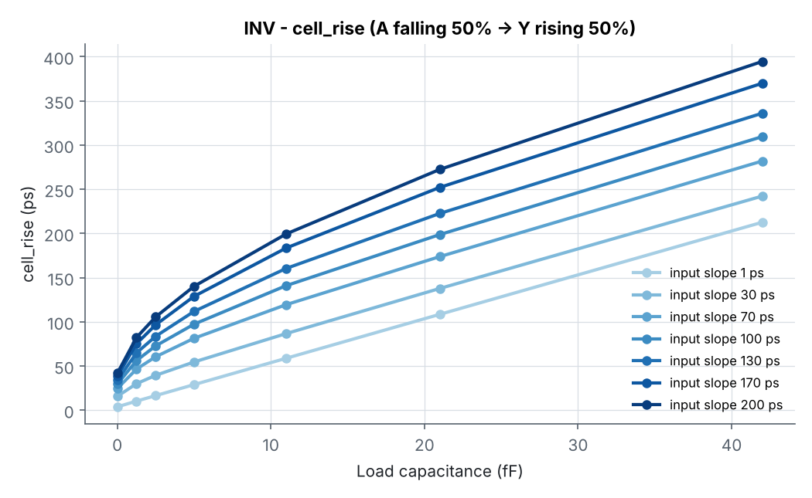
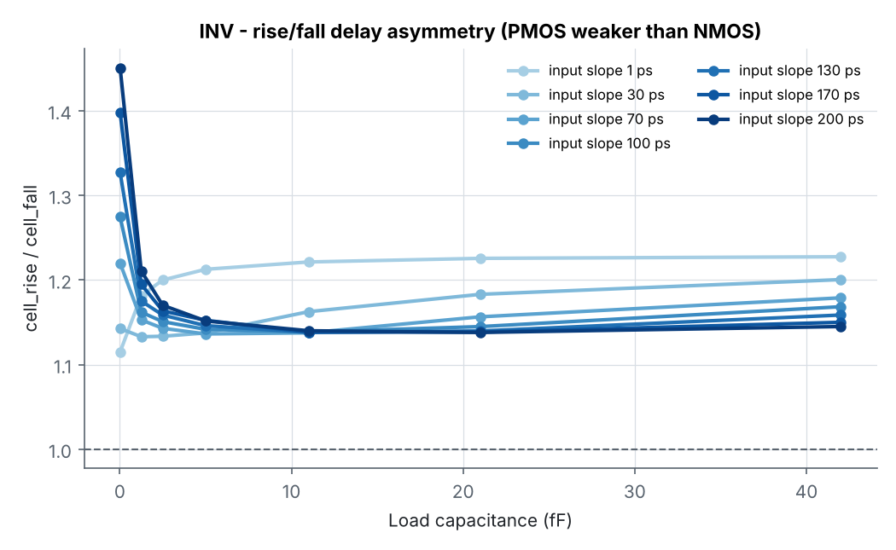
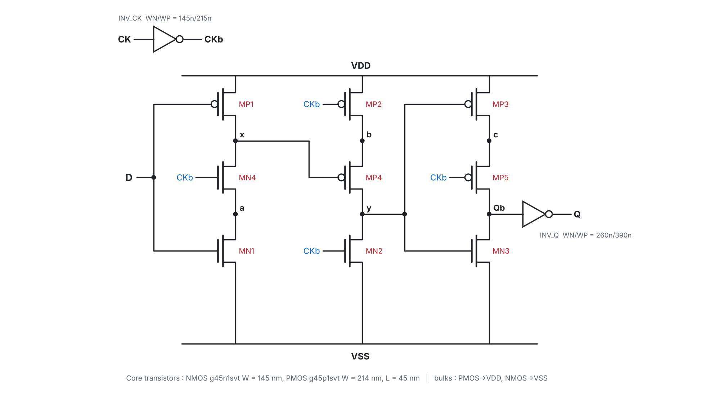
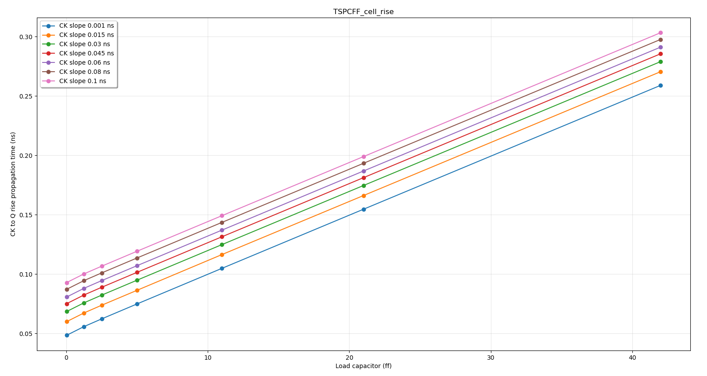
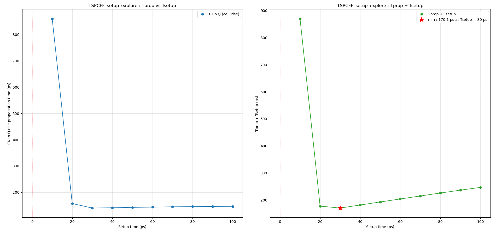

# TSPC-DFF-45: Design and Timing Characterization of a True Single-Phase Clock Flip-Flop in GPDK045

Transistor-level design and **Liberty-style timing characterization** of a standard cell D flip-flop built on the **TSPC (True Single-Phase Clock)** topology, using the Cadence **Generic 45 nm PDK (gpdk045 / gsclib045)** and **mixed-signal simulation** (SystemVerilog + Verilog-AMS on Xcelium / Spectre AMS).

The work follows the M2 *Integrated Circuits and Systems* course **ICS904 / CD2IC: Cell Design for Digital Integrated Circuits** (Télécom Paris / Université Paris-Saclay). It starts by validating the characterization methodology on a reference inverter, then applies it to the TSPC flip-flop: CK→Q propagation delay and setup time.

> **Status:** Parts I–IV(a) done: methodology, INV characterization, TSPCFF netlist, CK→Q delay, setup-time exploration. Next: dichotomy search for the optimal setup time, hold time, layout, post-layout characterization and optimization.

---

## Table of contents
1. [Context and objectives](#1-context-and-objectives)
2. [Characterization methodology](#2-characterization-methodology)
3. [Reference cell: INV characterization](#3-reference-cell-inv-characterization)
4. [TSPC flip-flop netlist](#4-tspc-flip-flop-netlist)
5. [TSPCFF CK→Q propagation time](#5-tspcff-ckq-propagation-time)
6. [TSPCFF setup-time exploration](#6-tspcff-setup-time-exploration)
7. [Issues met and how they were solved](#7-issues-met-and-how-they-were-solved)
8. [Summary of results](#8-summary-of-results)
9. [Repository layout and how to reproduce](#9-repository-layout-and-how-to-reproduce)
10. [Next steps](#10-next-steps)

---

## 1. Context and objectives

Front-end tools (synthesis, static timing analysis, place & route) never simulate transistors. They read **tabulated timing models** (Liberty `.lib` tables) indexed by **input transition time** and **output load capacitance**. Producing those tables means running many electrical simulations of the cell over a grid of operating points.

**Fixed operating conditions (whole project)**

| Parameter | Value |
|---|---|
| Process corner | Typical |
| Supply | 1.1 V |
| Temperature | 25 °C |
| Max transition, data signals | 200 ps |
| Max transition, clock signals | 100 ps |
| Max output load | load giving the max output transition |

**Characterization grid**

| Axis | Values |
|---|---|
| Input / data slope | 1, 30, 70, 100, 130, 170, 200 ps |
| Clock slope (TSPCFF) | 1, 15, 30, 45, 60, 80, 100 ps |
| Output load | 0.02, 1.25, 2.5, 5, 11, 21, 42 fF |

Delays are measured between **50 %** crossings of VDD. Transitions are measured between **30 %** and **70 %** of VDD.

---

## 2. Characterization methodology

The simulation mimics a physical lab bench, split into three levels:



- **Stimulus:** the testbench toggles logic signals. A `cmos_transition` module turns each logic edge into a realistic electrical ramp with the requested transition time (`tt_val`) and optional delay (`delay_val`).
- **Load:** an ideal capacitor whose value is updated through a `wreal` from the testbench, smoothed with `transition()` for convergence.
- **Measurement:** Verilog-AMS `@(cross(V(node) - threshold, direction))` events timestamp threshold crossings, and the difference is sent back to the testbench.
- **Self-check:** after every stimulus, the testbench compares the digital output with a reference model (`!din` for the INV, a behavioural DFF for the TSPCFF).

---

## 3. Reference cell: INV characterization

The methodology is first validated on the gsclib045-like inverter (NMOS 260 nm / PMOS 390 nm, L = 45 nm).

### 3.1 Output fall transition (`fall_transition`)

Measurement: output crossing 70 % → 30 % of VDD, for a rising input.



- The transition time grows almost linearly with load, as expected (RC discharge through the NMOS).
- The input slope matters mainly at small loads.
- The worst case (200 ps input, 42 fF) gives **178.7 ps**, still below the 200 ps limit. Linear extrapolation puts the **maximum load at ≈ 49 fF**.

### 3.2 Propagation delays (`cell_fall`, `cell_rise`)

| Measurement | Input edge (50 %) | Output edge (50 %) | Stimulus |
|---|---|---|---|
| `cell_fall` | A rising | Y falling | `din` 0 → 1 |
| `cell_rise` | A falling | Y rising | `din` 1 → 0 (polarity reversed in testbench) |

| cell_fall | cell_rise |
|---|---|
|  |  |

**cell_fall / cell_rise (ps)**: extract of the full tables in [`inv/results`](inv/results)

| input slope | 0.02 fF | 5 fF | 11 fF | 21 fF | 42 fF |
|---|---|---|---|---|---|
| 1 ps | 3.5 / 3.9 | 23.9 / 29.0 | 48.1 / 58.8 | 88.5 / 108.5 | 173.3 / 212.7 |
| 100 ps | 23.4 / 29.8 | 85.3 / 97.4 | 123.8 / 141.0 | 173.6 / 198.8 | 265.0 / 309.6 |
| 200 ps | 29.1 / 42.3 | 121.8 / 140.2 | 175.0 / 199.5 | 239.4 / 272.5 | 344.7 / 394.7 |

### 3.3 Rise / fall asymmetry



`cell_rise` is **1.13–1.23× larger** than `cell_fall` at every load ≥ 1 fF. The 390/260 = 1.5 PMOS/NMOS width ratio does not fully compensate the lower hole mobility, so the pull-up is weaker. At near-zero load the ratio depends strongly on the input slope, because the delay is dominated by the input ramp rather than by the output RC.

The load slope of the INV is **≈ 5.0 ps/fF for cell_rise** (212.7 − 3.9) / 42. This number becomes a cross-check in section 5.

---

## 4. TSPC flip-flop netlist



The positive-edge TSPC flip-flop uses a **single clock phase**. An input inverter generates `CKb`, and three dynamic/semi-static stages are followed by an output buffer.

| Stage | Transistors | Function |
|---|---|---|
| INV_CK | WN 145 nm / WP 215 nm | CK → CKb |
| 1 | MP1 (D), MN4 (CKb), MN1 (D) | x = !D while CK = 0, then frozen |
| 2 | MP2 (CKb), MP4 (x), MN2 (CKb) | y precharged low while CK = 0; y = !x = D on CK↑ |
| 3 | MP3 (y), MP5 (CKb), MN3 (y) | Qb = !y on CK↑, held while CK = 0 |
| INV_Q | WN 260 nm / WP 390 nm | Qb → Q (drives the load) |

- Core devices: **NMOS `g45n1svt` W = 145 nm**, **PMOS `g45p1svt` W = 214 nm**, L = 45 nm, bulks to the rails.
- The input and output inverters reuse the sizes of the library flip-flop **DFFQX1** (gsclib045), read from its schematic, so the comparison with the library cell is fair.
- The `INV` module was made **parametric** (`parameter real WN, WP`) and is instantiated with `INV #(.WN(..), .WP(..))`.

Source: [`tspcff/TSPCFF.vams`](tspcff/TSPCFF.vams)

---

## 5. TSPCFF CK→Q propagation time

**Board changes:** a second `cmos_transition` generator drives `clk_electrical`. The `tt_val`/`delay_val` signals are split into `din_*` and `clk_*`. The DUT is the TSPCFF, and the measurement is **CK rising 50 % → Q rising 50 %**.

**Testbench sequence per point** (D slope fixed at 10 ps, no extra delay):
1. `clk = 0, d = 0`, wait.
2. `clk = 1` to store 0, wait. Then `clk = 0`, wait.
3. `d = 1`, wait.
4. `clk = 1`, the measured edge (Q 0 → 1), wait.
5. Check `dout == dout_ref` (`always @(posedge clk) dout_ref <= din`), then record the delay.



| | 0.02 fF | 42 fF |
|---|---|---|
| CK slope 1 ps | ≈ 48 ps | ≈ 259 ps |
| CK slope 100 ps | ≈ 92 ps | ≈ 303 ps |

**Interpretation**
- **Intrinsic CK→Q ≈ 48 ps**, the sum of about four gate delays (INV_CK → stage 2 → stage 3 → INV_Q).
- **Load sensitivity ≈ 5.0 ps/fF**, identical to the INV `cell_rise` slope. This is expected because the output inverter INV_Q has the same 260/390 nm sizing and alone drives the load, so it independently confirms the netlist and the measurement chain.
- A slower clock edge shifts every curve up by about 45 ps between 1 ps and 100 ps, but doesn't change the slope.
- The functional self-check passed at all 49 operating points.

---

## 6. TSPCFF setup-time exploration

**Method:** D and CK rise at the **same logical instant**, and the CK electrical edge is delayed by `clk_delay_val`. With identical 100 ps slopes on D and CK, the delay between their 50 % crossings is exactly `clk_delay_val`, which is the **setup time**. The delay is swept from 100 ps down to 0 ps in 10 ps steps (CK slope 100 ps, load 11 fF), and the CK→Q delay is recorded at each step. A failed capture (Q stays 0) is logged instead of stopping the run.



| Setup time (ps) | 100 | 60 | 30 | 20 | 10 | 0 |
|---|---|---|---|---|---|---|
| CK→Q (ps) | ≈ 147 | ≈ 144 | ≈ 140 | ≈ 157 | ≈ 860 | capture fails |

**Interpretation**
- **Stable region (≥ 30 ps):** CK→Q is flat at about 140–147 ps, consistent with the section 5 value at the same conditions (≈ 149 ps @ 100 ps CK slope, 11 fF).
- **Degradation region (20 ps):** the internal node `x` has not fully settled when CKb falls, so stage 2 evaluates more slowly.
- **Metastability (10 ps):** CK→Q explodes to about 860 ps. The flip-flop still resolves to the correct value, but far too late.
- **Failure (0 ps):** D is not captured.
- **Optimal operating point:** for back-to-back flip-flops, the clock period must satisfy `Tclk > Tprop + Tcomb + Tsetup`, so the useful quantity is `Tprop + Tsetup`. Its minimum on this 10 ps grid is **≈ 170 ps at Tsetup ≈ 30 ps**. The exact minimum lies between 20 and 40 ps and will be refined to ±0.5 ps with a dichotomy search.

---

## 7. Issues met and how they were solved

| Symptom | Cause | Fix |
|---|---|---|
| Tutorial results not in `results/` | Template testbench writes `measurements.dat` | Explicit `results/<cell>_<meas>.dat` filenames, plus `mkdir -p results` |
| `cell_rise` must start from a high input | INV output only rises on a falling input | Reversed `din` polarity in the testbench (init 1, measure 1→0, reset 1) |
| `*E,ACCNAME ... Access function used as analog signal name` on `Q` | `Q()` is the Verilog-AMS charge access function. `disciplines.vams` was already loaded in full mode by `board.vams` before `TSPCFF.vams` set `VAMS_ELEC_DIS_ONLY` | Load disciplines **once**: `` `define VAMS_ELEC_DIS_ONLY`` + `` `include "disciplines.vams"`` at the top of `board.vams` (first analog file compiled). Remove the include from `cmos_transition.vams` and `TSPCFF.vams` |
| `*E,NDRDF Nature/discipline redefined` | In `VAMS_ELEC_DIS_ONLY` mode, including `disciplines.vams` in several files redefines `electrical` | Same fix: a single include |
| Behavioural DFF reference unusable for setup sweep | D and CK change at the same logical time, so `posedge clk` races with `din` | Check only `dout === 1` after the capture edge, and log failures instead of `$finish` |

---

## 8. Summary of results

| Cell | Quantity | Value |
|---|---|---|
| INV (260/390 nm) | Max load (fall transition ≤ 200 ps) | ≈ 49 fF |
| INV | cell_fall @ 1 ps, 42 fF | 173.3 ps |
| INV | cell_rise @ 1 ps, 42 fF | 212.7 ps |
| INV | cell_rise / cell_fall | 1.13–1.23 |
| INV | cell_rise load slope | ≈ 5.0 ps/fF |
| TSPCFF | CK→Q rise, intrinsic (1 ps CK, 0.02 fF) | ≈ 48 ps |
| TSPCFF | CK→Q rise load slope | ≈ 5.0 ps/fF |
| TSPCFF | CK→Q rise @ 100 ps CK, 11 fF | ≈ 140–149 ps |
| TSPCFF | Setup-time exploration: min(Tprop + Tsetup) | ≈ 170 ps @ Tsetup ≈ 30 ps (10 ps grid) |

---

## 9. Repository layout and how to reproduce

```
.
├── README.md                    this report
├── docs/figures/                all figures used above
├── inv/
│   ├── INV.vams                 reference inverter netlist (260n/390n)
│   ├── fall_transition/         board.vams, testbench.sv (tutorial)
│   ├── cell_fall/               board.vams, testbench.sv
│   ├── cell_rise/               board.vams, testbench.sv
│   └── results/                 *.dat simulator outputs
├── tspcff/
│   ├── TSPCFF.vams              parametric INV + TSPCFF netlist
│   ├── cell_rise/               board.vams, testbench.sv, plot.py
│   ├── setup_explore/           testbench.sv, plot.py (uses cell_rise/board.vams)
│   └── results/                 *.dat (copy from the lab machine)
└── tools/
    ├── make_figures.py          regenerates every plot from the .dat files
    └── draw_schematic.py        draws docs/figures/tspcff_schematic.png
```

**Not included:** the course framework files (`Makefile`, `cmos_transition.vams`, `amsXrunControl.scs`, `probes.tcl`, `.cdsenv`) and the PDK. They belong to the course and to Cadence. Each job directory is meant to be dropped into the course template directory (`make template_dir`).

**Running a job (on the lab machine)**
```bash
cd <job_dir>              # e.g. TSPCFF_cell_rise
mkdir -p results
make simu                 # Xcelium + Spectre AMS
make plot_results         # plot.py
make show_waves           # Viva waveform viewer
```

**Regenerating the figures**
```bash
pip install matplotlib numpy
python3 tools/make_figures.py
python3 tools/draw_schematic.py     # needs only matplotlib
```

---

## 10. Next steps

- [ ] **Setup time, part B:** dichotomy search of `min(Tprop + Tsetup)` to 0.5 ps, then over the full load × CK-slope grid.
- [ ] **cell_fall** of the TSPCFF (CK↑ → Q↓).
- [ ] **Hold time** extraction and its relation to setup time.
- [ ] **Layout** of the TSPCFF in Virtuoso (DRC / LVS).
- [ ] **Post-layout characterization** with extracted parasitics.
- [ ] **Optimization** of transistor sizing to minimize `Tprop + Tsetup`, and comparison with the library **DFFQX1**.

---

### Tools
Cadence Virtuoso 6.1.7 · Xcelium 21.09 (xrun, mixed-signal) · Spectre AMS · Viva · Python 3 / NumPy / Matplotlib

### Author
**Mubinur Rashid Tahjib**, M2 Integrated Circuits and Systems, Université Paris-Saclay
Course ICS904 / CD2IC *Cell Design for Digital Integrated Circuits*, Télécom Paris
